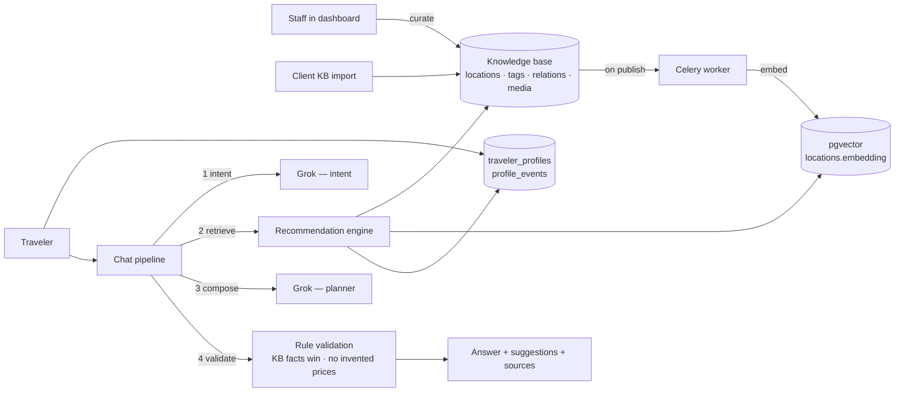
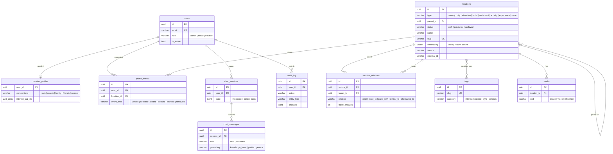

# WishTrip — Database & API Schema

How the data is structured, what each table holds, which API touches it, and how a request
flows through the system. Generated from the live database (`docker compose`, Postgres 17 +
pgvector) and the FastAPI routes on 2026-10-10.

- Interactive API docs (every request/response schema): http://localhost:8000/docs
- Raw OpenAPI spec: [dashboard/src/lib/api/openapi.json](../dashboard/src/lib/api/openapi.json)
- Models in code: `backend/app/modules/*/models.py` · migrations: `backend/alembic/versions/`

---

## 1. The big picture

**Source of truth = the knowledge base.** The LLM only reasons over what retrieval hands it,
and its output is checked against stored facts before anyone sees it.

---

## 2. Entity relationships

**Location hierarchy rule** (enforced in the API): `country` has no parent → `city` sits in a
`country` → every other type sits in a `city`. A location with children cannot be deleted.

---

## 3. Tables

Conventions: every table uses a UUID primary key `id` (except `traveler_profiles`, keyed by
`user_id`). Enums are stored as `varchar` and validated in the app, so adding a value needs no
migration. `created_at` / `updated_at` are `timestamptz` defaulting to `now()`.

### 3.1 `users` — accounts

| Column | Type | Null | Notes |
|---|---|---|---|
| email | varchar(255) | no | Unique, stored lowercase |
| hashed_password | varchar(255) | no | Argon2 |
| full_name | varchar(255) | no | |
| role | varchar | no | `admin` (everything), `editor` (knowledge base), `traveler` (profile, chat) |
| is_active | boolean | no | Disabled users cannot sign in |

Sign-up (`/auth/register`) always creates a `traveler`; staff accounts are created by admins.

### 3.2 `locations` — the knowledge base

One table for every kind of place; `type` says which.

| Group | Column | Type | Null | Notes |
|---|---|---|---|---|
| Identity | type | varchar | no | country, city, attraction, hotel, restaurant, activity, experience, route |
| | status | varchar | no | `draft` (hidden), `published` (travelers + AI), `archived` |
| | parent_id | uuid → locations | yes | Hierarchy; `ON DELETE RESTRICT` |
| | name, slug | varchar | no | `slug` unique, auto-generated |
| | region | varchar | no | e.g. "Kerala" on cities — lets travelers ask for a region |
| | aliases | text[] | no | Other names travelers use ("Dharamshala", "Munnar") |
| | highlight | boolean | no | Must-see; small ranking tie-breaker only |
| Basics | summary | varchar(500) | no | One line; shown in lists and given to the AI |
| | description | text | no | |
| | latitude, longitude | double | yes | |
| | address | varchar | no | Area / address |
| Travel | duration_minutes | int | yes | **The AI may never change this** |
| | best_times | text[] | no | morning / afternoon / evening / night |
| | seasons | text[] | no | spring / summer / autumn / winter |
| | opening_hours | jsonb | no | Free key/value, e.g. `{"open_days": "wed", "source": "…", "verified": "2026-08-16"}` |
| | cost_level | smallint | yes | 0 free … 4 luxury (CHECK 0–4) |
| | price_note | varchar | no | **Verified price only.** Empty ⇒ travelers see "price not available yet" |
| Character | energy_level | smallint | yes | 1 relaxed … 5 very active (CHECK 1–5) |
| | difficulty | smallint | yes | 1 easy … 5 strenuous (CHECK 1–5) |
| | family_friendly, couple_friendly, accessible | boolean | yes | `null` = unknown (never treated as "no") |
| Knowledge | pros, cons | text[] | no | |
| | tips | text | no | Insider tips |
| Provenance | source | varchar | no | `manual` or `goexperience-kb` (client import) |
| | external_id | varchar | yes | Unique with `source`; imports upsert on it |
| | provenance | jsonb | no | `needs_verification`, `coordinate_precision`, source ids/URLs |
| | reference | jsonb | no | **Staff-only unverified data** (indicative rates…). Never sent to travelers or the AI |
| Semantic | embedding | vector(768) | yes | Unit-length; HNSW cosine index `ix_locations_embedding` (iterative scans on) |
| | embedded_at | timestamptz | yes | Stale when `< updated_at` |
| | embedding_model | varchar | yes | Stale when ≠ current model → re-embed |

### 3.3 `location_relations` — the knowledge graph (in Postgres)

| Column | Type | Null | Notes |
|---|---|---|---|
| source_id, target_id | uuid → locations | no | `ON DELETE CASCADE`; CHECK source ≠ target |
| relation | varchar | no | near, route_to, pairs_with, similar_to, alternative_to |
| travel_minutes | int | yes | What the planner trusts (not straight-line distance) |
| distance_meters | int | yes | |
| note | varchar(500) | no | e.g. "drive — through backwater country (verified 2026-08-19)" |

Unique on `(source_id, target_id, relation)`; the API also rejects the reverse duplicate.

### 3.4 `tags` and `location_tags`

| Table | Columns |
|---|---|
| tags | `name`, `slug` (unique), `category` (interest / cuisine / style / amenity) |
| location_tags | `location_id`, `tag_id` — composite PK, both `ON DELETE CASCADE` |

Traveler interests (`traveler_profiles.interest_tag_ids`) match places through these tags.

### 3.5 `media`

| Column | Type | Null | Notes |
|---|---|---|---|
| location_id | uuid → locations | no | `ON DELETE CASCADE` |
| kind | varchar | no | image / video / influencer |
| storage_key | varchar | yes | Uploaded file on the `media` Docker volume, served at `/media/<key>` |
| external_url | varchar | yes | Or a link (YouTube, reel…) |
| content_type, caption, author | varchar | no | |
| sort_order | int | no | |

### 3.6 `traveler_profiles` — what travelers told us

| Column | Type | Notes |
|---|---|---|
| user_id | uuid PK → users | 1:1, `ON DELETE CASCADE` |
| budget_level, energy_level | smallint | 0–4, 1–5 |
| companions | varchar | solo / couple / family (with children) / friends / seniors |
| travel_styles, food_preferences, preferred_times | text[] | |
| interest_tag_ids | uuid[] | → tags |
| accommodation_preference, notes | varchar | |
| accessibility_needs | boolean | Hard constraint: excludes `accessible = false` places |

### 3.7 `profile_events` — what travelers did

`user_id`, `location_id`, `event_type`, `created_at`. Event weights in ranking:
viewed +0.1 · selected +0.5 · added +0.5 · booked +0.8 · skipped −0.4 · removed −0.6.
They shift both that place's score and the weight of its tags.

### 3.8 `chat_sessions` and `chat_messages`

| Table | Key columns |
|---|---|
| chat_sessions | `user_id`, `title`, `state` (jsonb: destination, duration_days, companions, budget/energy, preferred_times, interests — merged across turns) |
| chat_messages | `role`, `content`, `intent` (jsonb), `grounding`, `suggestions` (jsonb list), `sources` (KB refs used), `follow_ups`, `validation_notes` (fact checks applied), `itinerary` (days → items with start/end, travel, capacity), `feasibility` (status, changes, issues), `model`, `debug` (exact context given to the AI) |

Each suggestion: `name, type, location_id, from_knowledge_base, is_placeholder, day,
time_of_day, duration_minutes, price (null unless verified), why`.

### 3.9 `audit_log`

`user_id` (`ON DELETE SET NULL`), `user_email`, `action` (create/update/delete), `entity_type`
(location/relation/tag/media/user), `entity_id`, `changes` (jsonb), `created_at`.

---

## 4. API

All routes are JSON. Auth is a JWT bearer token (`Authorization: Bearer …`). Browsers never
call the backend directly:

| App | Browser calls | Forwards to backend | Session cookies |
|---|---|---|---|
| Dashboard (staff, :3001) | `/api/backend/*` | any route (backend enforces staff roles) | `wishtrip_staff_*` |
| Website (travelers, :3002) | `/api/wt/*` | **allowlist only**: `auth/me`, `profiles/me*`, `recommendations`, `search/semantic`, `chat/*`, `explore/*` — everything else 404s at the website | `wishtrip_traveler_*` |

Tokens live in httpOnly cookies; each app uses its own cookie names because browsers share
cookies across ports/subdomains of one host.

| Who | Can call |
|---|---|
| anonymous | `/health`, `/auth/login`, `/auth/register`, `/auth/refresh` |
| any signed-in user | `/auth/me`, `/profiles/me*`, `/recommendations`, `/search/semantic`, `/chat/*` |
| editor + admin | `/admin/*` except users |
| admin | `/admin/users*` |

### Auth & system
| Method | Path | Does | Tables |
|---|---|---|---|
| GET | /health | DB check, AI on/off, embedder name | — |
| POST | /auth/login | Email + password → access/refresh tokens | users |
| POST | /auth/register | Create traveler, return tokens | users |
| POST | /auth/refresh | Refresh token → new pair | users |
| GET | /auth/me | Current user | users |

### Knowledge base (staff)
| Method | Path | Does | Tables |
|---|---|---|---|
| GET | /admin/stats | Counts by type/status, incomplete, pending embeddings | locations, tags, relations |
| GET | /admin/locations | List; filters `type[]`, `parent_id`, `status`, `q`, `tag_id`, `source`, `region`, `needs_verification`, paging | locations |
| POST | /admin/locations | Create (hierarchy rules, slug, audit, embed if published) | locations, location_tags, audit_log |
| GET | /admin/locations/{id} | Detail + ancestors, completeness, children count, reference | locations |
| PATCH | /admin/locations/{id} | Partial update; re-embeds if content changed | locations, audit_log |
| DELETE | /admin/locations/{id} | Delete (409 if it has children) | locations (+cascades) |
| GET | /admin/locations/{id}/children-counts | Child counts per child (hierarchy tree) | locations |
| POST | /admin/locations/reindex | Queue embedding of stale published rows | locations |
| GET / POST | /admin/locations/{id}/relations | List both directions / add | location_relations |
| DELETE | /admin/relations/{id} | Remove relation | location_relations |
| GET / POST | /admin/tags | List / create | tags |
| DELETE | /admin/tags/{id} | Delete (removed from all locations) | tags, location_tags |
| GET / POST | /admin/locations/{id}/media | List / upload file or link (multipart) | media |
| DELETE | /admin/media/{id} | Delete file + row | media |

### Intelligence
| Method | Path | Does | Tables |
|---|---|---|---|
| GET | /search/semantic | `q`, `type[]`, `city_id`, `limit` → nearest published places | locations (vector) |
| GET / PUT | /profiles/me | Read / replace own profile | traveler_profiles |
| POST | /profiles/me/events | Record behaviour (selected, skipped…) | profile_events |
| GET | /recommendations | Ranked places for me, with score components + reasons | locations, profiles, events |
| GET | /admin/recommendations/preview | Same, for any traveler (inspector) | same |
| GET | /admin/travelers | Travelers with profile + event counts | users, traveler_profiles, profile_events |
| GET | /admin/travelers/{id} | Profile + recent events | same |

### Explore (public, read-only — published data only, no internal fields)
| Method | Path | Does | Tables |
|---|---|---|---|
| GET | /explore/destinations | Published cities with ≥1 place: region, country, place count, highlights | locations |
| GET | /explore/destinations/{id} | City + its published places (`type[]` filter) | locations |
| GET | /explore/places/{id} | Place detail: facts, pros/cons, tips, opening days, media, "pairs well with" | locations, media, location_relations |
| GET | /explore/tags | Interest/style/cuisine tags for preferences | tags |
| GET | /profiles/me/saved | My saved places (latest signal is a save) | profile_events, locations |

### Chat
| Method | Path | Does | Tables |
|---|---|---|---|
| GET / POST | /chat/sessions | My conversations / start one | chat_sessions |
| GET | /chat/sessions/{id} | Conversation with messages (+ debug) | chat_sessions, chat_messages |
| DELETE | /chat/sessions/{id} | Delete conversation | chat_sessions (+messages) |
| POST | /chat/sessions/{id}/messages | Send a message → runs the pipeline → assistant reply | all of the above |

### Users & audit (admin)
| Method | Path | Does | Tables |
|---|---|---|---|
| GET / POST | /admin/users | List (filter role) / create staff | users, audit_log |
| PATCH | /admin/users/{id} | Role, active, name, password | users, audit_log |
| GET | /admin/audit-log | Change history; filter entity type/id | audit_log |

---

## 5. How the main flows work

### 5.1 Chat message (`POST /chat/sessions/{id}/messages`)

1. **Intent** — the LLM's `intent` model turns the message into JSON: intent, destination,
   days, start date, companions, budget, energy, times, interests, place types, search query. Thinking is
   switched off for this step (structured and latency-sensitive). With no LLM, a keyword
   fallback does the same (benchmark: gemma4 11/12 messages, fallback 3/12).
2. **Trip state** — merged into `chat_sessions.state`, so later turns keep context.
3. **Resolve destination** — city name, alias ("Dharamshala" → McLeod Ganj, "Krabi" →
   Krabi (Ao Nang)), region ("Kerala" → 5 cities) or country. A named place we don't hold
   ⇒ **no retrieval**, answer labelled `general`. Plan/plan-change requests search all place
   types; targeted questions ("restaurants near Munnar") narrow by type.
4. **Retrieve** — per city: the recommendation engine (profile + session preferences) **plus**
   semantic search for what was literally asked. Top 12 become `[K1]…[K12]` with their facts
   (duration, hours, price or "NOT AVAILABLE", suitability, pros/cons, relations).
5. **Compose** — the LLM's `planner` model writes the reply and structured suggestions, citing `[Kn]`.

   | `LLM_PROVIDER` | intent model | planner model | endpoint |
   |---|---|---|---|
   | `ollama` (local) | `gemma4` | `gemma4` | `OLLAMA_BASE_URL/v1/chat/completions` |
   | `openrouter` (server) | `x-ai/grok-4.3` | `x-ai/grok-4.7` | `openrouter.ai/api/v1/chat/completions` |
   | `none` | keyword fallback | knowledge-base listing | — |

   One OpenAI-compatible client serves both; only URL, key, models and the reasoning switch
   differ (`reasoning_effort` on Ollama, `reasoning: {...}` on OpenRouter, with an automatic
   retry without it if a model insists on reasoning).
6. **Validate** — KB durations overwrite the model's; prices come only from `price_note`;
   currency amounts not in the KB are stripped from the text; hotels/flights not in the KB
   become marked placeholders; unknown refs are dropped. Every correction is recorded in
   `validation_notes`.
7. **Feasibility re-check** (deterministic, `app/modules/itinerary/feasibility.py`) — runs
   whenever the plan has days:
   - *Schedules* each day from 09:00 (09:30 for relaxed pace): slots (morning 08–12,
     afternoon 12–17, evening 17–21, night 20–24), opening windows, travel between stops.
   - *Travel time*: stored relations first (exact), then city-to-city routes, then distance
     (≤5 km at town speed, longer hops at road speed) — estimates are labelled.
   - *Checks*: trip length; day load vs pace (energy 1→5 h … 5→10 h of activity + travel);
     closed weekdays (when dates are known — otherwise an "only open on…" note); opening
     windows; best time of day; long transfers; hard constraints (accessibility, families
     with children, budget); duplicates.
   - *Repairs*: removes violations and duplicates, re-times items to their best time, moves
     items to open days with room (using real travel), drops the least important stop
     (never a highlight first) when a day is over, and refills empty days from other
     retrieved candidates that pass every check ("re-retrieve and repair").
   - *Status*: `feasible`, `repaired`, or `needs_attention` (a day still over capacity).
   - If anything changed, the planner rewrites its reply to match the final plan
     (`FEASIBILITY_REWRITE=true`), otherwise a "Plan check" note listing the changes is appended.
8. **Store** — the assistant message with intent, grounding, sources, the scheduled
   `itinerary`, the `feasibility` report and the exact context.

### 5.2 Recommendation ranking

Preference engine → candidate search → hard constraints → weighted score:

| Signal | Weight | Source |
|---|---|---|
| interest | 30% | Tag overlap with profile interests + behaviour-adjusted tag weights |
| semantic | 20% | Cosine similarity to the traveler's interests text |
| energy | 15% | Distance between place and preferred energy |
| budget | 10% | cost_level vs budget_level |
| companions | 10% | family/couple suitability |
| timing | 5% | best_times vs preferred_times |
| affinity | 10% | Past selected/skipped on this exact place |

Hard constraints remove a place before scoring: accessibility needs vs `accessible = false`,
cost more than one level above budget, families vs `family_friendly = false`.
`highlight` adds +0.02 as a tie-breaker only.

### 5.3 Embeddings

| `EMBEDDING_PROVIDER` | Model | Where |
|---|---|---|
| `ollama` | `embeddinggemma-2` (768-d native) | Local development, no key |
| `openrouter` | `google/gemini-embedding-2` (Matryoshka, cut to 768) | Online |
| `hashing` | word-overlap fallback | Tests / fully offline |
| `auto` | openrouter if a key is set, else hashing | |

All providers produce **768-dim, unit-length** vectors, so switching provider never needs a
schema change: each row stores `embedding_model`, and a different model marks it stale
(the overview's "Index now" re-embeds).

When re-embedding happens: publishing, editing an embedded field (name, summary,
description, tips, pros/cons, tags, parent, suitability, best time, seasons, energy, region,
status), deleting a tag the place carried, or renaming its parent city. The worker builds one
text document per place (name, type, city, summary, description, tags, best time,
suitability, pros, tips) and writes `embedding`, `embedded_at = now()`, `embedding_model`
**without touching `updated_at`** (embedding is derived data, not an edit). Drafts are never
embedded. Searches embed the query as a *query* and places as *documents* (EmbeddingGemma v1
task prompts; v2 benchmarks better without them).

**Quality (benchmarked with `python -m app.scripts.eval_embeddings`)** — 14 paraphrased traveler
queries that avoid the places' own words, over 494 published places:

| Provider | hit@5 | MRR@10 |
|---|---|---|
| hashing | 7% | 0.01 |
| ollama/embeddinggemma-2 | **100%** | **0.95** |

**Relevance cutoff** (used only when no destination narrows the search): off-topic queries
peak at ~0.70, real travel queries score 0.75–0.84 → cutoff `0.70` for embeddinggemma-2.
Re-run the benchmark (it prints this calibration) after adding the OpenRouter key and set
`RETRIEVAL_MIN_SIMILARITY` for Gemini if needed.

### 5.4 Client knowledge-base import

`client_work/tools/normalize.py` → `client_work/knowledge_base/*.json` →
`python -m app.scripts.import_client_kb` upserts on `(source, external_id)`, creates tags and
`route_to` relations, keeps hotels as drafts, then embeds published rows.

Safe to re-run:
- Each imported row stores `provenance.import_hash`, a fingerprint of what was imported.
  If staff have since edited the row (fingerprint no longer matches) or verified it, the
  import **leaves it alone** and reports it as "kept".
- Only fields whose values actually changed are written, so an unchanged re-import touches
  nothing and triggers no re-embedding (no wasted embedding cost).

---

## 6. Tests

| Suite | Command | Covers |
|---|---|---|
| Backend unit/integration | `cd backend && uv run pytest` | Services, rules, ranking, chat validation (test DB `wishtrip_test`) |
| API (live) | `cd dashboard && pnpm test:api` | All 39 endpoints against the running backend; every call logged |
| Dashboard E2E (headed) | `cd dashboard && pnpm test:e2e` | Every page in a visible Chromium, with the API calls each page makes |
| Report | `cd dashboard && pnpm test:report` | HTML report with per-test API call attachments, traces on failure |
